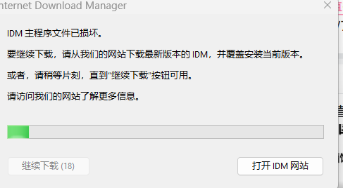

# IDM 6.43.7.2 网页下载弹窗修复记录

我用的是 UP主 “刺客边锋” 的 IDM 绿色版（关于该版本可关注他的公众好免费获取。解压后的目录名是 `【刺客边风】IDM.6.43.7.Green`，主程序 `IDMan.exe` 的文件版本是 **6.43.7.2**。这份记录对应的是我本机这一个构建。

## 遇到的问题

在浏览器网页上触发下载，由 IDM 接管时，会弹出「IDM 主程序文件已损坏」。弹窗出现后，得等倒计时结束才能点「继续下载」。点完文件能正常下完，但每次触发都要等。

## 检查结果

- 浏览器能把下载交给 IDM，点「继续下载」后下载也能完成。问题发生在 IDM 接管任务之后。
- Windows 将这份绿色版的 `IDMan.exe` 标记为未签名。同目录的浏览器通信组件 `IDMMsgHost.exe` 有有效的 Tonec 签名。
- 在这份 `IDMan.exe` 里找到了调用弹窗的分支。修改前，Windows PE 文件头里存的校验和已经与重新计算的值一致，因此单独重算校验和无法解决这个弹窗。警告最初由什么触发，仍未确认。

## 实际修改

备份原始 `IDMan.exe` 后，只修改主程序里控制这个弹窗的一条跳转指令，并重新计算 PE 校验和。这里的偏移量从文件开头计算。

| 位置 | 修改前 | 修改后 |
| --- | --- | --- |
| `0x9B2BF`，跳转指令 | `74 0D`，条件跳转 | `EB 0D`，无条件跳转 |
| `0x150`，PE 校验和字段（4 字节，小端序） | `9B 50 5D 00` | `9C C7 5C 00` |

原来当条件不满足时，程序会调用弹窗并等待用户操作。改成无条件跳转后，这条路径直接进入已有的下载流程。逐字节比较确认，文件实际变了 **4 个字节**，其中 1 个属于跳转指令，另外 3 个属于校验和字段。

### 用 SHA-256 核对文件

| 文件 | SHA-256 |
| --- | --- |
| 修改前的 `IDMan.exe` | `4069568485665A19673ECF60484D9E10E77F19CE014A2452D85F51D1176F1CFE` |
| 修改后的 `IDMan.exe` | `F56382AEDD2B1A63315E2CD95D80D447CCCF22561DFBC17EB94536B14DF432D7` |

在 PowerShell 里可运行 `Get-FileHash -LiteralPath 'IDMan.exe' -Algorithm SHA256`。文件版本相同也可能有不同的打包内容。偏移量和字节值只适用于上表对应的文件。

## 测试和恢复

先在副本上核对指令和校验和，再退出 IDM、备份原文件并应用修改。重启 IDM 后，我在浏览器里实测，下载可以继续，原来的倒计时弹窗没有再出现。

需要回退时，先彻底退出 IDM。将程序目录里形如 `IDMan.exe.before-popup-fix-日期时间.bak` 的原始备份复制为 `IDMan.exe`，覆盖修改后的主程序，再启动 IDM。

这个仓库收录修复记录和弹窗截图。
